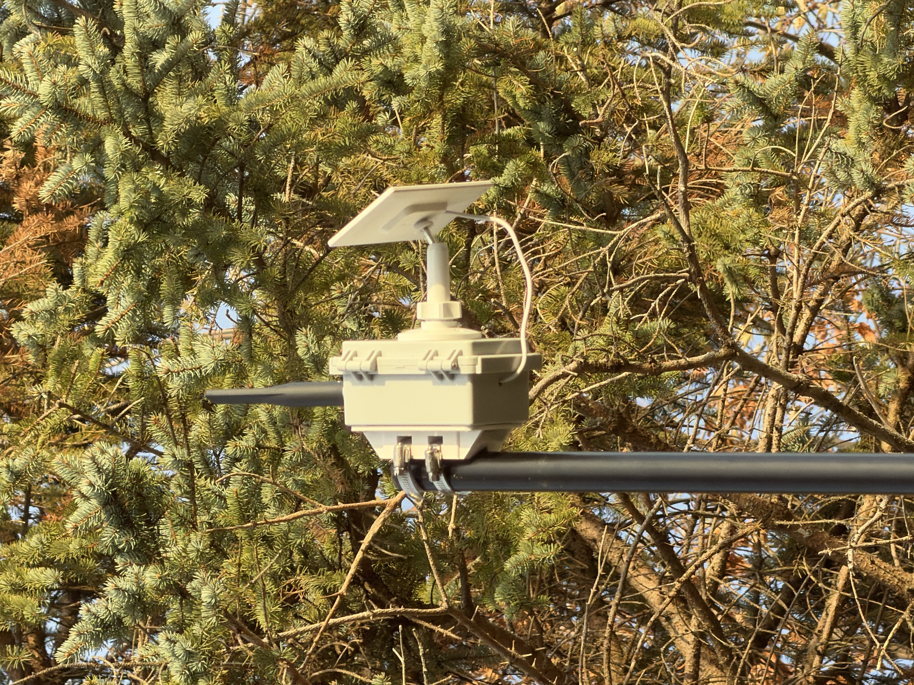

## LoRa in General

The Mesh networks provide another means of off-grid communications in the 900 MHz band, using text messages. LoRa also allows for data communication and monitoring of sensors across the network. Three popular networks exist within the LoRa world, and the hardware works with all three. MeshCore and Meshtastic are two off-grid text-based messaging protocols for use as an alternate means of communications. What's used the most depends on what the area is accepting. For example, the plains states (Iowa, the Dakotas, Missouri) use Meshtastic almost exclusively. Others, like Wisconsin, Michigan, Illinois and Minnesota focus on MeshCore.

## MeshCore

MeshCore is an open-source LoRa mesh platform for sending text off-grid — no internet, no cell, no subscription. It runs on the same cheap LoRa boards as Meshtastic; it’s just different firmware.

Its big idea is roles. Instead of every node relaying everything (which gets noisy fast), MeshCore splits the network into companions, repeaters, and room servers. Companion radios don’t rebroadcast by default, so the airwaves stay clear and the mesh scales cleanly — you grow coverage by placing repeaters up high, not by adding chatter.  (lifted from [RFLab.io: Meshcore](https://rflab.io/topics/meshcore.html))

HVARC members have been participating in MeshCore activity since 2026 Along with UWP-ARC (UW Platteville's student club) to install repeaters, beginning in Platteville. The area backbone repeater is **UWP-1-Platteville-Mound**, which covers a wide area of Grant, Iowa and Lafayette Counties and links us to the rest of the **Madison mesh**. The UWP Club has also installed a campus repeater on Ottensman Hall's roof, **UWP-6-Otts**. Both of these repeaters been installed high enough to be connected to from potentially as far away as Potosi, Lancaster, and Hazel Green. It is part of a larger scale mesh cenetering around Madison and includes Dodgeville, Janesille/Beloit, Portage, Sauk City, and beyond to Milwaukee and Chicago. HVARC and UWP-ARC are working to install a repeater on the Hospital roof to take advantage of its location on high ground and its line of sight around the area.

Individual members have already set up companion radios (used with smart phone apps to send messages and manage repeaters) ,installed Meshcore repeaters on their homes, and/or set up observers and room servers.

As Meshcore is a networked mesh, strategic placement of repeaters goes a long way to making sure data is properly and efficiently transmitted/received. Room Servers provide a means of message storage for later retrieval. Either of these can double as the role of "Observer", which collects info on repeaters and rooms and maps them for reference. [RFLab.io](https://rflab.io/index.html). Tools are present to help set up infrastructure in your home, as well as for large scale tower installs.

### Resources
- [Official Site](https://meshcore.io)
- [MeshCore docs](https://docs.meshcore.io/?utm_source=chatgpt.com)
- [RFLab.io](https://rflab.io) - [Discord](https://discord.gg/SRxKpRWrBQ)- Wisconsin-based community dedicated to promoting and providing resources on mesh - focusing on Meshcore tools
- Meshmapper: A real-time map of repeaters/room servers and a grid-based record of coverage mapped to the repeaters.
- CoreScope: live monitor of the mesh network worldwide as the hop from repeater to repeater, with details of the packet types for examination and improvement
- Tower Map: Map of existing Wisconsin towers that could be candidates for new wide-area repeaters - with a tool to calculate reachability.

## Meshtastic

Meshtastic turns an inexpensive radio board into a node on a self-healing mesh network. Each node can send and receive short text messages and share GPS location, and — crucially — every node relays for the others. A message hops node to node until it reaches you, so the network’s reach grows with every person who joins.

It runs over LoRa (Long Range) radio in a license-free band, so anyone can use it — no ham license, no SIM card, no monthly bill. Messages are encrypted with AES-256 by default. It’s a favorite for hiking, overlanding, events, emergency prep, and just covering a town with a community network.

While there are opportunities for working with Meshtastic in Dubuque and beyond into Iowa, and it's alive in parts of Wisconsin such as Milwaukee. we have had little luck in getting going with this form of mesh. However if individual members wish to participate, they are welcome to. (lifted from [RFLab.io: Meshtastic](https://rflab.io/topics/meshtastic.html))

### Resources
- [Official Site](https://www.meshtastic.org)
- [MeshConsin](https://meshconsin.org/#about) - [Discord](https://discord.gg/f3cU7kPbHg) - Wisconsin resource site
